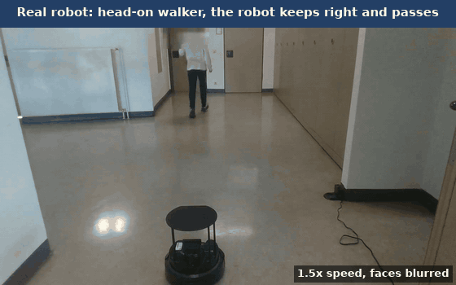
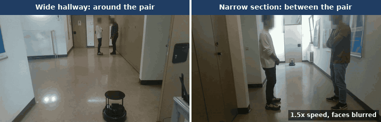

# Social Navigation on a real TurtleBot 4 (ROS 2 Humble)

Robot side of the master's thesis **"Lightweight Socially-Aware Navigation via Human Motion Prediction and Scene Understanding"** (Deggendorf Institute of Technology, Campus Cham, 2026). The simulation, the results in simulation and the ablation are in the companion repository [Turtlebot4-Social-Navigation-Jazzy-Simulation-](https://github.com/Brian-Lim-Tze-Zhen/Turtlebot4-Social-Navigation-Jazzy-Simulation-).

The pipeline runs on a host PC in a Docker container and drives a physical TurtleBot 4 over Wi-Fi.

**Stack:** ROS 2 **Humble** · CycloneDDS (direct, no Discovery Server / zenoh) · AMCL + Nav2 MPPI · YOLO (Ultralytics/OpenVINO) + MobileCLIP-S1 · RPLiDAR · OAK-D

## Pipeline
```
OAK-D ─► YOLO ─► camera_ray_person_node ─► camera_ray_identity_node ─┐
RPLiDAR /scan ──────────────────────────────────────────────────────┘
      ─► Kalman filter predictor ─► predicted person cloud ─► Nav2 costmap ─► MPPI (+ SocialLaneNoGhostCritic)
      ─► social group detector ─► social zone layer
```

## Results on the robot



*Head-on walker, final robot configuration, 12 October 2026 (filmed extra run `headon_rec20gsvideo_run01`, not one of the ten counted runs). The robot keeps to its right and passes without stopping.*



*Standing pair, same day: around the pair in the wide hallway (counted run 1) and between the members in the narrow section (counted run 3). Both played at 1.5x speed; faces blurred frame by frame.*

Final robot configuration, 12 October 2026, ten counted runs per case in the hallway of the university (thesis Section 7.6.2). On the robot there is no ground truth: the distance is the nearest LiDAR return that is not on the map, and the surface clearance is that distance minus the robot radius of 0.189 m. Mean ± SD in metres.

| Case | Nearest return | Surface clearance | Robot's path | Stops | Time (s) |
|---|---|---|---|---|---|
| Head-on walker | 0.669 ± 0.150 | 0.480 ± 0.150 | passed on the right 10 / 10 | 1 (turn at the start of one run) | 26.5 ± 1.1 |
| Standing pair, wide hallway | 0.766 ± 0.068 | 0.577 ± 0.068 | around the pair 10 / 10 | 0 | 25.6 ± 1.0 |
| Standing pair, narrow section | 0.556 ± 0.046 | 0.367 ± 0.046 | between the members 10 / 10 | 0 | 28.8 ± 0.9 |

Without group skip (9 October 2026) the robot reached similar distances, but a lane was started for a member of the standing pair in seven of ten runs in each place, because a standing member's estimate jumps at the hand-over between camera and LiDAR. With group skip a lane started in one of twenty runs, for a short extra track in front of the pair. Measured the same way in simulation, the wide pair matches the robot within 0.001 m. Photos and RViz views of one run of each case (faces blurred) are in the thesis, Figures 7.5 to 7.7.

## Quick start

```bash
git clone https://github.com/Brian-Lim-Tze-Zhen/Turtlebot4-Hardware-Humble.git ~/Desktop/Turtlebot4
git clone https://github.com/SteveMacenski/nonpersistent_voxel_layer.git ~/Desktop/Turtlebot4/humble_client/workspace/src/nonpersistent_voxel_layer
xhost +local:root
cd ~/Desktop/Turtlebot4/humble_client && docker compose build && ./run_humble_client.sh

# inside the container
cd /root/thesis_social_navigation_ws && colcon build --symlink-install && source install/setup.bash
ros2 launch launch/robot_day_all.launch.py          # the final configuration, everything except the recorder
```

Before building, change the Wi-Fi interface and subnet in the `Dockerfile` and the group IDs in `docker-compose.yaml` to match your machine ([HOW_TO_RUN.md](HOW_TO_RUN.md), section 1). Recorded runs are started from the laptop with `workspace/scripts/run_scenario_hw_v4.sh` (section 3).

## Documentation

| File | What it holds |
|---|---|
| [HOW_TO_RUN.md](HOW_TO_RUN.md) | requirements, set-up, the final configuration and its run commands, the earlier configurations compared in the thesis, folder structure, known problems |
| [humble_client/Task/](humble_client/Task/) | run records of the robot days (5, 8, 9 and 12 October 2026): every counted and discarded run with its reason |
| [humble_client/Turtlebot4_Documentation.md](humble_client/Turtlebot4_Documentation.md) | hardware notes and issue log |
